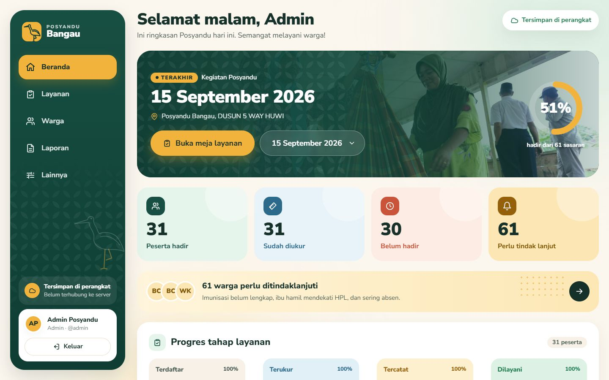
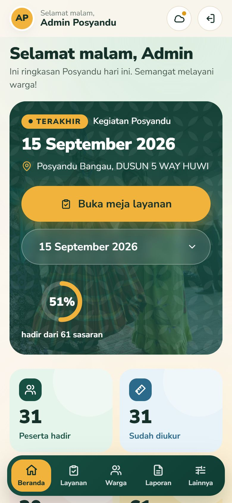
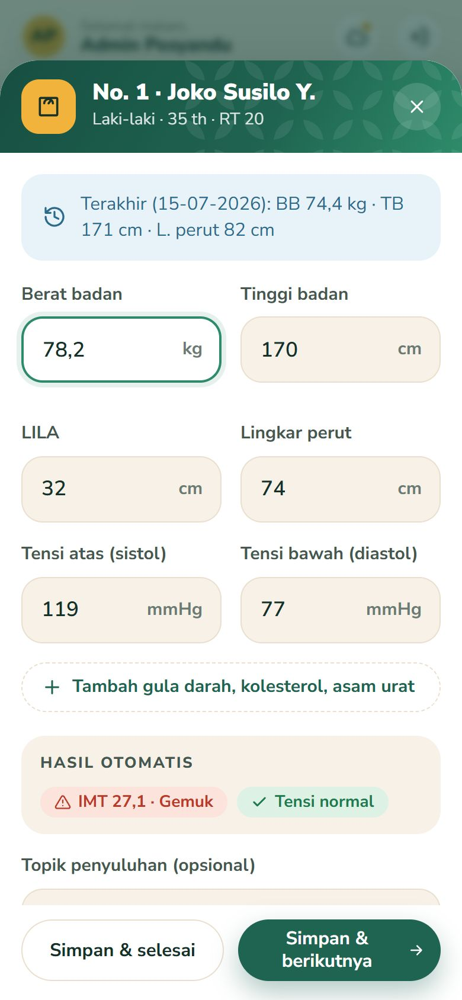
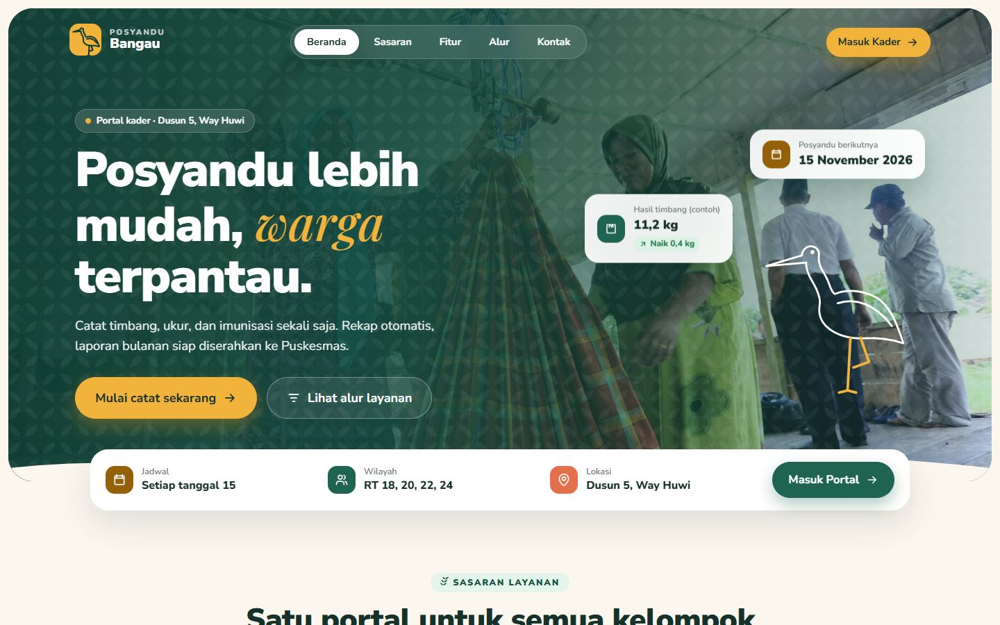
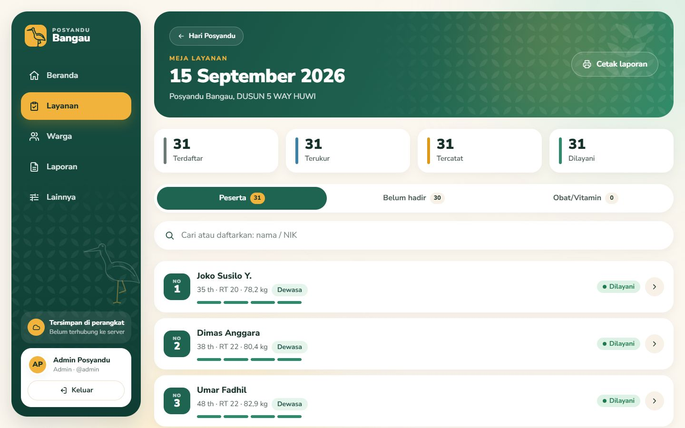
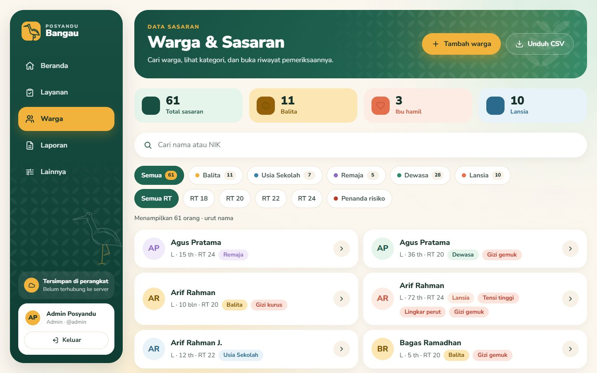
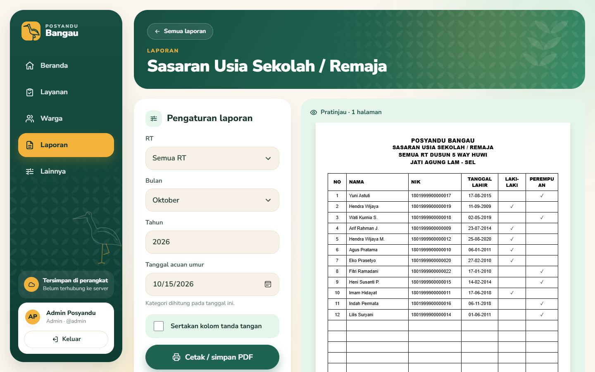

<div align="center">


# Posyandu Bangau · Portal Kader

Aplikasi web untuk kader Posyandu Bangau mencatat timbang, ukur, imunisasi, dan pemeriksaan warga.
Catat sekali, rekap otomatis, laporan bulanan siap dicetak untuk Puskesmas.

Dusun 5, Desa Way Huwi, Kec. Jati Agung, Lampung Selatan

</div>



<p align="center">
  
  &nbsp;
  
</p>

> Semua nama, NIK, dan angka pada gambar di atas adalah **data contoh fiktif** dari menu Lainnya > Muat data contoh.

## Daftar isi

- [Tentang](#tentang)
- [Fitur](#fitur)
- [Teknologi](#teknologi)
- [Memulai](#memulai)
- [Dua mode penyimpanan](#dua-mode-penyimpanan)
- [Memasang ke internet](#memasang-ke-internet)
- [Struktur proyek](#struktur-proyek)
- [Desain](#desain)
- [Batasan dan keamanan data](#batasan-dan-keamanan-data)
- [Kredit](#kredit)

## Tentang

Kader Posyandu biasanya mencatat di buku besar lalu menyalin ulang ke format laporan bulanan. Aplikasi ini menggantikan langkah itu:

- dibuat untuk HP lebih dulu (mobile-first), dengan huruf dan tombol besar, ikon selalu bertulisan, dan status selalu disertai kata;
- tetap jalan tanpa internet, data tersimpan di perangkat;
- bisa disambungkan ke server bersama (Supabase, paket gratis) supaya beberapa kader memakai data yang sama dari HP masing-masing.

Dibuat untuk mata kuliah Kapita Selekta Informatika, Kelompok 5, Institut Teknologi Sumatera (ITERA), bermitra dengan Posyandu Bangau.

## Fitur

| Menu | Isi |
|---|---|
| **Beranda** | Ringkasan kegiatan: persentase kehadiran, peserta hadir, sudah diukur, belum hadir, progres tahap layanan, grafik peserta per kategori dan per RT, penanda risiko. |
| **Layanan** | Daftar hari Posyandu dan meja layanan: daftarkan warga ke antrean, isi BB, TB, LILA, lingkar perut, tensi, gula darah, kolesterol, asam urat. IMT dan penanda risiko langsung terhitung. Catat pemberian obat cacing dan vitamin A. |
| **Warga** | Data sasaran dengan pencarian, filter kategori, RT, dan penanda risiko. Kategori umur (Balita, Usia Sekolah, Remaja, Dewasa, Lansia) dihitung otomatis dari tanggal lahir. Detail warga berisi grafik berat badan, riwayat pemeriksaan, imunisasi dasar, dan buku ibu hamil (HPHT, perkiraan lahir, persalinan). Ekspor CSV. |
| **Tindak lanjut** | Bayi 12-23 bulan yang imunisasinya belum lengkap, ibu hamil yang mendekati HPL, warga yang absen 2 kegiatan terakhir, dan warga dengan penanda risiko. |
| **Laporan** | 8 laporan dengan format sama seperti laporan manual Posyandu, lengkap dengan pratinjau dan cetak atau simpan sebagai PDF ukuran A4. |
| **Lainnya** | Ganti kata sandi, identitas Posyandu (kop laporan), batas umur kategori, ambang batas pemeriksaan, akun kader (buat, ubah peran, nonaktifkan, hapus), server bersama, cadangan dan impor data, riwayat perubahan. |

Laporan yang tersedia:

1. Sasaran Balita
2. Sasaran Ibu Hamil / Menyusui
3. Sasaran Usia Sekolah / Remaja
4. Sasaran Lansia
5. Data Sasaran Dewasa Lansia (kunjungan bulanan)
6. Kartu Bantu Pemeriksaan Dewasa Lansia
7. Hasil Pemeriksaan (kartu gula darah, kolesterol, asam urat)
8. Pemberian Obat Cacing / Vitamin A

Fitur lain:

- **Bisa dipasang seperti aplikasi (PWA).** Setelah dibuka sekali dari hasil build, aplikasi bisa ditambahkan ke layar utama HP dan dibuka tanpa internet.
- **Impor dari Excel.** Simpan buku besar sebagai CSV, lalu impor sekaligus. Baris yang salah ditunjukkan sebelum disimpan.
- **Riwayat perubahan.** Menyimpan 500 perubahan terakhir, yang lebih lama terhapus otomatis.

<details>
<summary>Gambar halaman lain</summary>






</details>

## Teknologi

- [React 18](https://react.dev) + [TypeScript](https://www.typescriptlang.org) + [Vite 5](https://vitejs.dev)
- [Dexie](https://dexie.org) (IndexedDB) untuk penyimpanan di perangkat
- [Supabase](https://supabase.com) (opsional) untuk login dan sinkronisasi antar perangkat
- [React Router](https://reactrouter.com) dengan HashRouter, jadi bisa dihosting statis tanpa pengaturan server
- [Vitest](https://vitest.dev) untuk tes
- Font Nunito Sans dan Playfair Display, dibundel lewat Fontsource agar tetap tampil saat offline

## Memulai

Prasyarat: [Node.js](https://nodejs.org) 18 atau lebih baru.

```bash
git clone https://github.com/AW2606/posyandu.git
cd posyandu
npm install
npm run dev
```

Buka alamat yang muncul di terminal (biasanya http://localhost:5173), lalu:

1. Klik **Masuk Kader** dan masuk dengan akun bawaan `admin` / `admin123`.
2. Untuk mencoba, buka **Lainnya > Data dan cadangan > Muat data contoh (fiktif)**.
3. Segera ganti kata sandi di **Lainnya > Ganti kata sandi**.

Akun bawaan ini hanya ada di mode lokal. Jika berkas `.env` berisi alamat Supabase, aplikasi masuk mode server dan memakai akun dari Supabase.

### Perintah

| Perintah | Kegunaan |
|---|---|
| `npm run dev` | Menjalankan server pengembangan |
| `npm run build` | Cek tipe lalu membuat hasil siap pasang di folder `dist/` |
| `npm run preview` | Mencoba hasil build secara lokal (PWA dan mode offline hanya aktif di sini, bukan di `dev`) |
| `npm test` | Menjalankan tes (umur dan kategori, IMT, lingkar perut, sinkronisasi, definisi laporan, batas riwayat perubahan) |

## Dua mode penyimpanan

| | Mode lokal | Mode server bersama |
|---|---|---|
| Data tersimpan di | Browser perangkat itu saja | Perangkat dan Supabase, tersinkron otomatis |
| Akun | Dibuat di perangkat itu | Dibuat Admin dari aplikasi, berlaku di semua HP |
| Hak akses Admin/Kader | Hanya pembatas tampilan | Ditegakkan di server (Row Level Security) |
| Tanpa internet | Jalan penuh | Jalan penuh, perubahan dikirim saat online lagi |
| Biaya | Gratis | Gratis (paket gratis Supabase) |

Untuk memakai mode server:

1. Buat proyek Supabase dan jalankan [`docs/supabase.sql`](docs/supabase.sql) di **SQL Editor**. Langkah lengkap ada di [`docs/supabase.md`](docs/supabase.md).
2. Salin `.env.example` menjadi `.env`, lalu isi:

   ```env
   VITE_SUPABASE_URL=https://xxxxxxxx.supabase.co
   VITE_SUPABASE_ANON_KEY=kunci-anon-public
   ```

   Pakai kunci **anon public**, jangan `service_role`. Berkas `.env` sudah diabaikan git.
3. Build ulang. Semua HP yang membuka alamat aplikasi otomatis terhubung ke server yang sama.

Supabase paket gratis menjeda proyek yang lama tidak dipakai. [`docs/keepalive.yml`](docs/keepalive.yml) adalah GitHub Action yang memanggil server dua kali seminggu agar proyek tetap aktif.

## Memasang ke internet

Hasil `npm run build` berupa berkas statis di `dist/`, jadi bisa dipasang di hosting statis gratis seperti Netlify, Vercel, Cloudflare Pages, atau GitHub Pages. Aplikasi memakai alamat relatif dan HashRouter, jadi tidak perlu aturan rewrite.

Jika memakai mode server, isi `VITE_SUPABASE_URL` dan `VITE_SUPABASE_ANON_KEY` sebagai variabel lingkungan di layanan hosting sebelum build.

## Struktur proyek

```text
├── desain/                 Berkas desain FigCraft dan diagram sistem (PNG)
├── docs/
│   ├── supabase.md         Panduan menghubungkan Supabase
│   ├── supabase.sql        Skema, aturan akses, dan fungsi server
│   ├── keepalive.yml       GitHub Action agar Supabase gratis tidak dijeda
│   ├── field-mapping.md    Pemetaan kolom laporan ke data
│   ├── template-inventory.md  Daftar template laporan manual
│   └── screenshots/        Gambar untuk README
├── public/                 Ikon, manifest PWA, service worker
└── src/
    ├── assets/foto/        Foto untuk halaman depan dan latar
    ├── components/         Komponen UI bersama, dialog pemeriksaan, kartu imunisasi/kehamilan
    ├── lib/                Logika: umur, kesehatan, database, sinkronisasi, impor CSV, autentikasi
    ├── pages/              Satu berkas per halaman
    ├── reports/            Definisi laporan (terpisah dari tampilan cetaknya)
    ├── styles.css          Sistem desain aplikasi
    └── landing.css         Halaman depan dan halaman masuk
```

## Desain

Desain dibuat di FigCraft (`desain/posyandu-bangau.figcraft`) untuk tiga ukuran layar: desktop 1440, tablet 834, dan HP 390, beserta halaman sistem desain.

- **Warna:** hijau daun sebagai warna utama, kunyit untuk ajakan, latar krem, dan warna tetap per kategori sasaran (Balita kunyit, Usia Sekolah biru, Remaja ungu, Dewasa hijau, Lansia koral).
- **Huruf:** Nunito Sans untuk semua teks, Playfair Display miring hanya untuk aksen.
- **Ilustrasi:** maskot bangau gaya garis, pola batik kawung, dan tangkai daun.

Diagram sistem (use case, aktivitas, ERD, sequence, arsitektur, DFD, peta navigasi, state kunjungan) ada di `desain/diagram/`.

## Batasan dan keamanan data

- Aplikasi ini **alat bantu pencatatan, bukan alat diagnosis medis.** Penanda risiko hanya berdasarkan angka ambang.
- Angka ambang (IMT, lingkar perut, tensi, gula darah, kolesterol, asam urat) dan batas umur kategori adalah nilai bawaan. Konfirmasikan ke bidan Puskesmas, lalu sesuaikan di menu Lainnya.
- Di mode lokal, data hanya ada di satu perangkat. **Unduh cadangan JSON secara berkala** dari menu Lainnya.
- Jangan pernah meng-commit data warga asli. `.gitignore` sudah mengabaikan `*.csv`, `*.xlsx`, `*.pdf`, berkas cadangan, dan `.env`.
- Sinkronisasi sudah diuji dengan tes otomatis dan server tiruan. Uji juga di proyek Supabase sungguhan sebelum dipakai untuk data nyata.

## Kredit

Foto dari Wikimedia Commons:

- *Monitoring baby's weight* dan *Membuat Perubahan untuk Ibu dan Bayi*, USAID Indonesia (domain publik)
- *Kader Lokal*, Lefaan (CC BY-SA 4.0)
- *Timbang Balita di Posyandu Porendeang*, Yansen Ricco (CC BY-SA 4.0)
- *Imunisasi di Masa Pandemi*, Focusfeel (CC BY-SA 4.0)

Kelompok 5, Kapita Selekta Informatika, Institut Teknologi Sumatera, bersama kader Posyandu Bangau.
